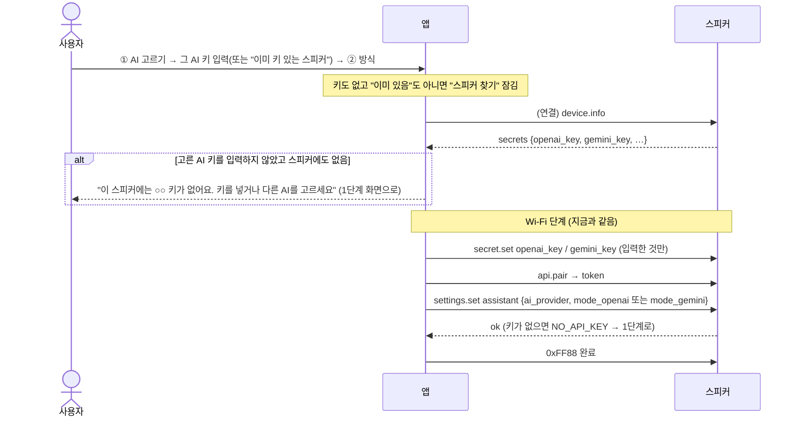
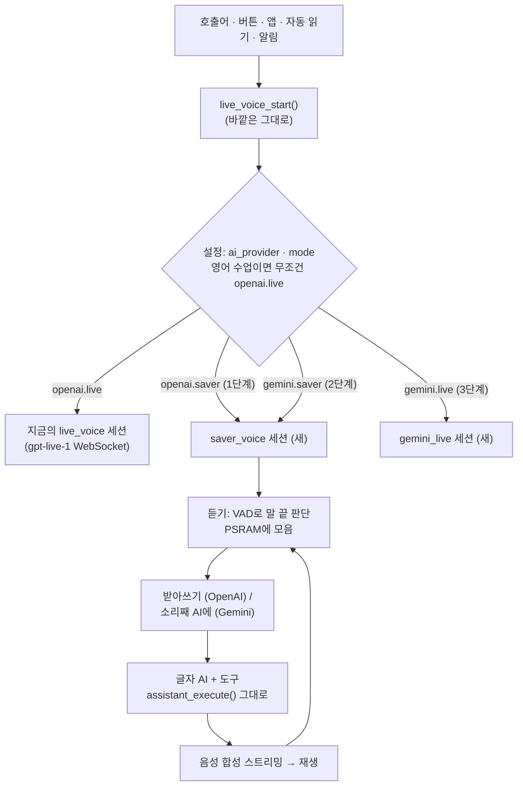
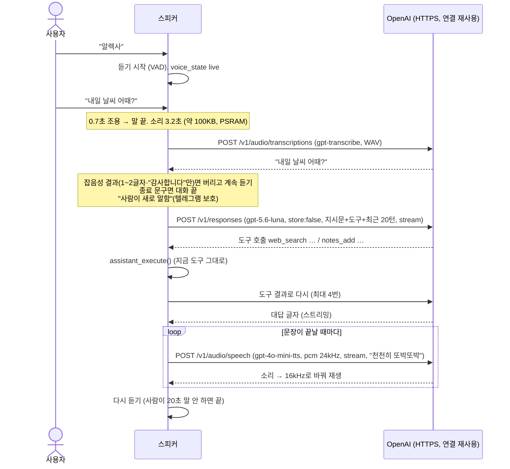

# 설계: AI 회사(OpenAI / Gemini) × 대화 방식(실시간 / 절약 모드) 고르기

- 작성일: 2026-10-04
- 상태: **결정 완료 (2026-10-04), 디자인 캔버스 확인 → 구현** (디자인: "AI 고르기 · 실시간 / 절약 모드" 줄)
- 요청 1: "앱에서 설정으로 '실시간(gpt-live-1)'과 '절약 모드'를 골라 쓰게 해 줘" (하루 1시간이면 한 달 약 $90이라 부담)
- 요청 2: "똑같이 Gemini API 키도 쓸 수 있게, Gemini용 설정에서도 실시간·절약 모드를 고르게 해 줘"

---

## 0. 고를 수 있는 네 가지

| | 실시간 | 절약 모드 |
|:--|:--|:--|
| **OpenAI** | gpt-live-1 (지금) | 받아쓰기 `gpt-transcribe` → `gpt-5.6-luna` → `gpt-4o-mini-tts` |
| **Gemini** | Gemini Live `gemini-3.8-live` | 소리를 바로 `gemini-3.1-flash-lite`에 (받아쓰기+생각 한 번에) → `gemini-3.8-flash-lite-tts` |

한 달 예상 (하루 1시간 사용, 사람 말 15분·스피커 말 15분, 왕복 60번 — 추정):

| | 실시간 | 절약 모드 |
|:--|:--|:--|
| OpenAI | 약 $90 (약 126,000원) | 약 $10~12 (약 14,000~17,000원) |
| Gemini | 약 $25~35 (약 35,000~50,000원) | **약 $6~8 (약 8,000~11,000원)** |

Gemini 절약 모드 계산: 소리 입력 25토큰/초 × 900초 × $0.50/100만 = $0.01, 대화 글자 입력 약 24만 토큰 × $0.25/100만 = $0.06, 글자 출력 $0.01, 합성 25토큰/초 × 900초 × $6/100만 = $0.14 → 하루 약 $0.22.
**Gemini는 무료 사용분의 데이터를 제품 개선에 쓴다 → 가족 대화·메모가 있으니 유료(결제 연결) 키를 권한다.**

---

## 1. 두 방식

| | 실시간 (지금) | 절약 모드 (새로) |
|:--|:--|:--|
| 구조 | gpt-live-1 한 번에: 듣기·생각·말하기 | 3단계: **받아쓰기 → 글자 AI → 음성 합성** |
| 요금 기준 | **연결된 시간** (말 안 해도) | **실제로 말한 양**만 (기다리는 시간 0원) |
| 대답 시작까지 | 0.5~1초 | **1.5~3초** |
| 말하는 중 끼어들기 | 됨 | 안 됨 (가운데 버튼으로 멈추기는 됨) |
| 도구 (메모·일정·텔레그램·라디오·설정·검색) | 됨 | 됨 (같은 도구) |
| 목소리 | gpt-live 목소리 | TTS 목소리 (비슷한 이름, 아래 5.5) |

---

## 2. 타당성 검토

### 2.1 요금 (2026-10 OpenAI 가격표 기준, 하루 1시간 "사용")

가정: 1시간 중 사람이 말하는 시간 15분, 스피커가 말하는 시간 15분, 대화 왕복 60번.

| 항목 | 단가 | 하루 |
|:--|:--|:--|
| 받아쓰기 `gpt-transcribe` | 분당 $0.0045 × 15분 (말한 구간만 보냄) | $0.07 |
| 글자 AI `gpt-5.6-luna` | 입력 100만 토큰 $0.20(캐시 $0.02), 출력 $1.20. 왕복당 약 4천 토큰 입력(대부분 캐시)·150 토큰 출력 × 60 | $0.02~0.05 |
| 음성 합성 `gpt-4o-mini-tts` | 출력 오디오 100만 토큰 $12 ≈ 분당 약 $0.015 × 15분 | $0.23 |
| 웹 검색 (쓸 때만) | 1회 $0.01 | 0~$0.05 |
| **합계** | | **약 $0.3~0.4 / 일** |
| **한 달** | | **약 $10~12 (약 14,000~17,000원)** |

실시간(gpt-live-1, 분당 $0.05)은 같은 사용에 **하루 $3, 한 달 $90**. → **약 8분의 1.**
가장 큰 몫은 음성 합성. 스피커가 짧게 말할수록 더 싸진다(지시문에 "짧게").

### 2.2 기술 확인

| 필요한 것 | 스피커에서 가능? | 근거 |
|:--|:--|:--|
| 말이 끝났는지 판단 (VAD) | ✅ | esp-sr에 VADNet(`vadnet1_medium`)·WebRTC VAD 포함. 마이크 처리(AEC 뒤 소리)에 붙인다. 모델 파티션 3MB 중 지금 약 0.6MB 사용 |
| 말한 소리 올리기 | ✅ | 16kHz 16비트 = 초당 32KB. 15초 = 480KB → PSRAM에 모았다가 HTTPS로 한 번에 (`/v1/audio/transcriptions`) |
| 글자 AI + 도구 | ✅ | Responses API(`/v1/responses`) 함수 호출. 영어 수업 정리에서 이미 Responses API를 쓰고 있다. 도구 실행은 지금의 툴 워커·`assistant_execute()` 그대로 |
| 음성 합성 재생 | ✅ | `/v1/audio/speech` `pcm`(24kHz) 스트리밍 → 16kHz로 변환(esp_audio_effects 리샘플러) → 지금의 음성 재생 큐. 받는 대로 바로 재생해 첫 소리를 빨리 낸다 |
| 메모리 (내부 RAM 약 18KB) | △ | TLS 연결을 **동시에 하나만** 쓴다(받아쓰기 → AI → 합성 순서). 지금의 대화 WebSocket도 TLS 하나이므로 같은 수준. 소리·대화 기록은 PSRAM. **같은 연결 재사용(keep-alive)**으로 TLS 협상을 줄인다 |
| 대화 기록 | ✅ | 최근 대화 20턴을 PSRAM에 두고 매번 보낸다(`store:false`, 서버에 남기지 않음). 지시문은 앞에 고정 → 캐시 할인 |
| 웹 검색 | ✅ | Responses API의 `web_search` 도구 |
| 종료 문구 ("잘가 컴퓨터") | ✅ | 받아쓰기 결과에 지금의 매처(`hangup_phrase`)를 그대로 |

### 2.3 대답 속도 (추정)

말 끝 판단 0.5초 + 받아쓰기 0.5~1초 + AI 첫 글자 0.5~1초 + 음성 첫 소리 0.3~0.5초 ≈ **1.8~3초**.
줄이는 방법: 연결 재사용, AI 답을 **문장 단위로 끊어 바로 합성**(스트리밍), 도구가 필요 없는 짧은 대답 우선.

### 2.4 잃는 것

- 말하는 중에 끼어들기(바로 멈추고 듣기): 1단계에서는 **가운데 버튼**으로만 멈춘다. ("컴퓨터"로 끼어들기는 2단계, 스피커 소리가 마이크에 들어와 오인식 위험 → AEC 검증 필요)
- 감정·억양이 실시간보다 덜 자연스러울 수 있다.
- 영어 수업: 발음 교정·프리토킹은 실시간이 훨씬 낫다 → **영어 수업은 늘 실시간**(5.4).

**결론: 타당하다.** 요금 약 1/8, 대답 1~2초 느려짐. 기존 도구·보호 장치·알림을 그대로 쓴다.

### 2.5 Gemini 쪽 확인

| 필요한 것 | 가능? | 메모 |
|:--|:--|:--|
| 키 | ✅ | Google AI Studio API 키(문자열 하나). 지금 OpenAI 키처럼 앱 → BLE로 스피커 보안 저장소에, 폰에도 기억 |
| Gemini 실시간 | ✅ | Live API WebSocket(`BidiGenerateContent`). 입력 16kHz PCM(지금과 같음), 출력 24kHz → 16kHz 변환. 함수 호출·끼어들기 지원. 웹 검색은 Google 검색 도구(월 5,000회 무료, 그 뒤 1,000회당 $14) |
| Gemini 절약 | ✅ | `generateContent`에 소리(WAV)를 바로 넣어 대답 글자 받기 → 받아쓰기 단계가 없어 OpenAI 절약보다 **한 단계 짧다**. 단, 종료 문구("잘가 컴퓨터")·텔레그램 보호용 "사람이 말한 글"이 필요하므로 대답과 함께 **받아쓴 글도 돌려 달라고**(JSON 출력) 요청 |
| 합성 | ✅ | `gemini-3.8-flash-lite-tts`, 출력 PCM 24kHz |
| 도구 | ✅ | 함수 선언 형식이 OpenAI와 조금 다름 → 도구 목록 하나에서 두 형식으로 변환 |
| 백엔드 맡기기 | 다름 | gpt-live-1의 "백엔드 모델에 맡기기"가 없다 → 도구를 직접 부른다(절약 모드와 같은 방식) |

---

## 3. 전체 구조

```
호출어/버튼 ─▶ voice_engine (설정에 따라)
                 ├─ openai + live  : 지금의 live_voice (gpt-live-1 WebSocket)
                 ├─ gemini + live  : gemini_live (새, Live API WebSocket)
                 └─ * + saver      : saver_voice (새, 아래 3단계. 회사별로 요청 형식만 다름)
                              듣기(VAD로 말 끝 판단, PSRAM에 모음)
                              → 받아쓰기 HTTPS → 글자 AI(Responses, 도구) ⇄ 툴 워커
                              → 문장마다 음성 합성 HTTPS(스트리밍) → 재생
                              → 다시 듣기 … 30초 동안 말 없으면 끝 (기다리는 동안 요금 0)
```

- 바깥(메인·앱·LED·버튼·알림·텔레그램 자동 읽기)은 지금처럼 `live_voice_start/stop/active/state`만 부른다. 그 아래에서 방식에 따라 갈라지게 해서 **다른 기능을 고치지 않는다.**
- `voice_state_t`(듣는 중·생각 중·말하는 중)를 똑같이 알려서 LED·앱 표시는 그대로.

---

## 4. 설정

| 키 | 값 | 기본 |
|:--|:--|:--|
| `ai_provider` | `"openai"` \| `"gemini"` | `openai` (키가 Gemini만 있으면 `gemini`) |
| `voice_mode` | `"live"` \| `"saver"` | **saver**(새로 설정하는 스피커) / 기존 스피커는 `live` 유지 — 9절 결정 |

- 회사마다 방식을 따로 기억한다(`openai.voice_mode`, `gemini.voice_mode`). 회사를 바꾸면 그 회사에서 마지막으로 고른 방식으로.
- 키: 보안 저장소에 `openai_key`, `gemini_key` 둘 다 둘 수 있다. 고른 회사의 키가 없으면 대화 시작 때 "앱에서 ○○ 키를 넣어 주세요" 안내.

- 비서 설정(`assistant settings`)에 추가. LAN API `PUT /api/v1/settings/assistant`(기존)로 바꾼다.
- 음성으로도: "절약 모드로 바꿔 줘" → `set_voice_mode` 툴(부작용 툴, 텔레그램 보호 목록에 추가). 다음 대화부터 적용.

---

## 5. 스피커 상세

### 5.1 듣기
- 호출어 → 대화 시작음 → 듣기. VAD가 말을 감지하면 모으기 시작, **0.7초 조용하면 말 끝**. 말 최대 30초.
- 30초 동안 말이 없으면 대화 끝(지금 무응답 30초와 같음). **기다리는 동안 요금 없음.**
- 앞 0.3초를 미리 버퍼에 두어 말 첫머리가 잘리지 않게.

### 5.2 받아쓰기
- `POST /v1/audio/transcriptions` (`gpt-transcribe`, WAV, `language: ko`는 쓰지 않고 자동 — 영어 섞인 말 대비).
- 결과가 비었거나 잡음성(1~2글자, "감사합니다"만 등)이면 무시하고 계속 듣기 → TV·잡음으로 AI 호출 요금이 나가지 않게.

### 5.3 글자 AI
- `POST /v1/responses`, 모델 `gpt-5.6-luna`, `store:false`, 지시문 = 지금의 실시간 지시문을 **말로 읽기 좋게 짧게** 다듬은 것 + 도구 목록(지금과 같은 JSON 스키마).
- 도구 호출 → 툴 워커 → 결과를 붙여 다시 요청(최대 4번). 텔레그램 보호(TLG-14)는 그대로: "사람이 새로 말함" = 새 받아쓰기 결과.
- 답은 스트리밍으로 받아 **문장이 끝날 때마다** 합성에 넘긴다.

### 5.4 영어 수업·알림·자동 읽기
| 기능 | 절약 모드에서 |
|:--|:--|
| 영어 수업 | **늘 실시간**(앱에 "영어 수업은 실시간으로 진행돼요" 안내). 9절 결정 |
| 일정 알림 | 알릴 문장을 AI 없이 스피커가 직접 만들어 **음성 합성만** → 가장 싸다. 그 뒤 15초 듣기("알았어", "10분 뒤 다시") |
| 텔레그램 자동 읽기 | "○○님 메시지: …"를 음성 합성으로 읽고 15초 듣기. 답장은 듣기 단계에서 |
| 마이크 보정 | 실시간으로 진행 (흐름이 실시간 전용) |

### 5.5 목소리
- TTS 목소리 목록이 다르다(alloy, ash, ballad, coral, echo, fable, nova, onyx, sage, shimmer 등). 비서 설정의 목소리를 같은 이름이 있으면 그대로, 없으면 가장 비슷한 것으로.
- TTS `instructions`: "천천히, 또박또박, 따뜻하게" (어르신용).

### 5.6 메모리·안정성
- 소리 버퍼 PSRAM 1MB(30초), 대화 기록 PSRAM, 새 태스크 1개(스택 PSRAM, 지금 대화 태스크와 동시에 돌지 않음 → 대화 태스크를 함께 쓰는 쪽을 우선 검토).
- 네트워크 실패: "잠깐 연결이 안 돼요" 안내음 + 다시 듣기, 3번 연속 실패면 대화 끝.
- 로그: 단계별 시간만(`SAVER: heard 2.1 s → text 0.8 s → ai 0.9 s → first audio 0.4 s`), **내용은 남기지 않는다.**

---

## 6. 앱

- **첫 설정 1단계(키 입력)**: OpenAI 키와 **Gemini 키 중 하나 이상**. 둘 다 넣어도 된다. 폰에 기억(지금 OpenAI 키처럼).
- **비서 설정 화면**에 "AI" 카드: **OpenAI / Gemini** 고르기(키가 있는 쪽만 고를 수 있고, 없으면 "키 넣기"로). 키 바꾸기는 BLE 창이 필요(지금처럼).
- 그 아래 "대화 방식" 카드: 두 개 중 하나 고르기(회사별 요금 문구)
  - **절약 모드** — "요금이 약 8분의 1. 대답이 1~2초 늦어요. 말하는 중에는 가운데 버튼으로 멈춰요."
  - **실시간** — "가장 자연스러워요. 대화 중 연결된 시간만큼 요금이 나가요(OpenAI 분당 약 70원 / Gemini 약 1/3)."
  - 아래 한 줄: "영어 수업은 늘 실시간으로 해요."
- 홈의 상태 카드에 지금 방식을 작게 표시(예: "절약 모드").
- 디자인은 캔버스에 먼저(비서 설정 화면 수정).

---

## 7. 단계·작업량

| 단계 | 내용 | 예상 |
|:--|:--|:--|
| 1 | 설정·앱 화면(회사·방식·Gemini 키), 방식 나누기 틀, **OpenAI 절약 모드**(VAD·받아쓰기·AI 도구·합성), 알림·자동 읽기를 합성으로 | 펌웨어 6~8일, 앱 1~2일, 실기기 2~3일 |
| 2 | **Gemini 절약 모드** (1단계 틀에 요청 형식만 추가) | 2~3일 |
| 3 | **Gemini 실시간** (Live API) | 4~6일 |
| 4 | "컴퓨터"로 끼어들기, 응답 속도 다듬기 | 3~4일 |

---

## 8. 위험

| 위험 | 대응 |
|:--|:--|
| 대답이 3초 넘게 늦으면 답답함 | 생각 중 LED·짧은 효과음, 연결 재사용, 문장 단위 합성. 실기기에서 단계별 시간 측정 |
| TV 소리를 계속 받아쓰기 → 요금·엉뚱한 대답 | 잡음성 결과 무시, 짧은 말 무시, 호출어로 시작한 대화만 |
| 내부 RAM 부족(TLS) | TLS 하나만 순서대로, 실기기에서 대화 중 내부 RAM 로그 |
| 실제 요금이 추정과 다름 | 1주 써 본 뒤 OpenAI Usage로 다시 계산 |

---

## 9. 결정 (2026-10-04 사용자)

| # | 질문 | 결정 |
|:--|:--|:--|
| 1 | 기본값 | 제안대로(새 스피커 절약, 지금 스피커 실시간) 시작하되 **앱에서 언제든 바꿀 수 있게** |
| 2 | 영어 수업 | **늘 실시간(OpenAI)**. 앱 영어 선생님 화면과 AI 설정 화면에 "실시간 API를 써요 · 분당 약 70원"을 알린다. OpenAI 키가 없으면 영어 수업을 열 수 없다 |
| 3 | 끼어들기 | **실시간에서만**. 절약 모드는 가운데 버튼으로 멈춤 |
| 4 | 고르는 순서 | **① AI(OpenAI / Gemini) 먼저 → ② 그 AI의 실시간 / 절약 모드**. 회사마다 마지막 방식을 기억 |
| 5 | 키 | **OpenAI·Gemini 키 둘 다 앱(휴대폰 보안 저장소)에 기억**해 두고 필요할 때 다시 보낸다. 스피커에 **키가 없는 AI는 고를 수 없다**(화면에서 잠김, "키 넣기" 안내). 첫 설정에서는 둘 중 하나 이상 |
| 6 | 순서 | 1단계 OpenAI 절약 → 2단계 Gemini 절약 → 3단계 Gemini 실시간 → 4단계 다듬기 |
| 7 | 디자인 | 캔버스 확인 후 구현: 첫 설정(AI → 필수 키 → 방식), 비서(AI·대화 방식 줄), 새 화면 "AI · 대화 방식", 영어 선생님(실시간 안내) |
| 8 | 새 스피커 등록 | **고른 AI의 키가 없으면 등록할 수 없다.** 첫 설정에서 그 AI의 키를 넣거나, "이미 이 AI 키가 저장된 스피커예요"를 고르면 연결 뒤 `device.info`로 확인. 둘 다 아니면 "스피커 찾기"가 잠김 |
| 9 | 설정 변경 | 비서 > "AI · 대화 방식"에서 AI와 실시간/절약을 언제든 바꾼다 |

**키가 없을 때 동작**
- 앱: 키가 없는 AI 카드는 흐리게, 누를 수 없음, "키 없음 · 쓸 수 없어요". 아래 "○○ 키 넣기"(가운데 버튼 3초 → 블루투스로 보냄).
- 스피커: 설정된 AI의 키가 없으면(예: 키를 지움) 대화를 시작하지 않고 "앱에서 ○○ 키를 넣어 주세요"라고 안내(LED 오류). 앱 `/status.secrets`에 `gemini_key`를 추가해 키가 있는지 알려 준다.
- 키 이름: 스피커 보안 저장소 `openai_key`, `gemini_key`(새로). 블루투스 `secret.set` 허용 목록과 LAN `DELETE /keys/{name}`에 `gemini_key` 추가.

## 10. (처음 질문 — 9절에서 결정됨)

1. **기본값**: 새 스피커는 절약 모드, 지금 스피커는 실시간 유지(앱에서 바꿈) — 괜찮은가? 아니면 지금 스피커도 절약 모드로?
2. **영어 수업은 늘 실시간** — 괜찮은가?
3. **끼어들기**: 1단계는 가운데 버튼으로 멈추기만 — 괜찮은가?
4. **디자인**: 비서 설정·키 입력 화면 수정을 캔버스에서 먼저 볼 것인가?
5. **영어 수업 + Gemini**: 영어 수업은 지금 OpenAI(gpt-live-1 + 정리)로만 만들어져 있다. Gemini만 쓰는 경우 ① 영어 수업은 OpenAI 키가 있을 때만(1단계) ② Gemini 실시간으로도 수업(3단계 이후) — ①로 시작해도 되는가?
6. **순서**: 1(OpenAI 절약) → 2(Gemini 절약) → 3(Gemini 실시간) 순서로 가도 되는가? (요금을 가장 빨리 줄이는 순서)

---

## 11. 상세 설계 (구현용)

### 11.1 설정 값

비서 설정(`assistant` 그룹, NVS `assistant/settings`)에 키 3개를 더한다. 지금은 키가 정확히 10개여야 통과하므로(`SETTINGS_KEYS 10`, `settings_valid`) **13개로 늘리고, 옛 설정(10개)은 읽을 때 기본값을 채워 옮긴다**(timezone을 더할 때와 같은 방식).

| 키 | 값 | 기본 (새 스피커) | 기본 (옮겨 온 스피커) |
|:--|:--|:--|:--|
| `ai_provider` | `"openai"` \| `"gemini"` | 첫 설정에서 고른 값 | `"openai"` |
| `mode_openai` | `"live"` \| `"saver"` | 첫 설정에서 고른 값(제안 `saver`) | `"live"` (지금 쓰던 그대로) |
| `mode_gemini` | `"live"` \| `"saver"` | `"saver"` | `"saver"` |

- 회사마다 방식을 따로 두어 "회사를 바꾸면 그 회사에서 마지막으로 고른 방식"이 된다(9절 4).
- 바꾸는 길: LAN `PUT /api/v1/settings/assistant` (앱 "AI · 대화 방식"), 첫 설정은 BLE `settings.set` (`group:"assistant"`), 말로는 나중(2단계 이후 검토).
- **키 검사 (스피커가 직접)**: `ai_provider`를 키가 없는 회사로 바꾸려 하면 거절 → LAN **409 `NO_API_KEY`**, BLE `{"ok":false,"error":"NO_API_KEY"}`. 앱이 화면에서 막지만 스피커도 한 번 더 막는다.

### 11.2 키

| 이름 | 스피커 저장 | BLE `secret.set` | LAN `DELETE /keys/{name}` | `/status.secrets`·`device.info.secrets` |
|:--|:--|:--|:--|:--|
| `openai_key` | `secrets` 영역 (지금) | ✅ | ✅ | ✅ |
| `gemini_key` | `secrets` 영역 **(새로)** | ✅ (1~512바이트) | ✅ | ✅ `gemini_key: true/false` |

- 앱: 보안 저장소 `vault_openai_key`, `vault_gemini_key`(새로). "이 휴대폰에 키 기억하기"가 켜져 있으면 저장, 다음 첫 설정·"키 넣기" 때 자동으로 채운다.
- **지금 고른 AI의 키를 지우면**(`DELETE /keys/openai_key` 등) 스피커는 대화를 시작하지 않고 `error NO_API_KEY`(앱: "앱에서 ○○ 키를 넣어 주세요"). 다른 회사 키가 있으면 앱이 "AI를 Gemini로 바꿀까요?"를 제안한다.

### 11.3 첫 설정 흐름 (바뀐 부분)



### 11.4 상태와 가능 여부 알리기

단계별로 만들어 가므로(9절 6), 스피커가 **지금 펌웨어에서 쓸 수 있는 조합**을 알려 주고 앱은 나머지를 "준비 중"으로 잠근다.

`GET /status`에 추가:

```json
"ai": {"provider":"openai","mode":"saver",
       "available":["openai.live","openai.saver"]}
```

| 단계 | `available` |
|:--|:--|
| 1단계 | `openai.live`, `openai.saver` |
| 2단계 | + `gemini.saver` |
| 3단계 | + `gemini.live` |

앱 "AI · 대화 방식": 키 없음 → "키 없음 · 쓸 수 없어요", 키는 있는데 `available`에 없음 → "준비 중". 홈 상태 카드에 "OpenAI · 절약 모드"처럼 작게 표시.

### 11.5 스피커 구조



- **바깥 함수는 그대로**: `live_voice_start/stop/active/ready/state`, `voice_state` 이벤트, 무응답 20초·최대 10분, 종료 문구, 가운데 버튼. 그래서 메인·앱·LED·알림·텔레그램 자동 읽기는 고치지 않는다.
- **영어 수업**: `lesson_wants_session()`이면 설정과 상관없이 `openai.live`. OpenAI 키가 없으면 `lesson/start`가 409 `NO_API_KEY`(앱: "영어 수업은 OpenAI 키가 필요해요").
- **끼어들기**: 실시간만. 절약 모드는 스피커가 말하는 동안 마이크 소리를 올리지 않는다(메아리 받아쓰기 문제도 함께 없어짐). 가운데 버튼 짧게 = 지금 대답 멈추고 듣기, 길게 = 대화 끝.

### 11.6 절약 모드 한 바퀴 (OpenAI, 1단계)



| 부분 | 내용 |
|:--|:--|
| VAD | esp-sr `vadnet1_medium` (또는 WebRTC VAD) — AEC 뒤 소리에. 말 시작 0.3초 앞부분 미리 보관, 0.7초 조용하면 끝, 말 최대 30초 |
| 연결 | api.openai.com HTTPS **하나를 계속 재사용**(keep-alive). TLS는 동시에 하나만 → 내부 RAM은 지금 대화와 같은 수준 |
| 지시문 | 지금 실시간·백엔드 지시문을 하나로 합치고 "짧게, 말로 읽기 좋게"를 더함. 도구 목록은 **지금 백엔드 위임(`delegation.responses.tools`)과 같은 Responses 형식 그대로** 재사용 |
| 대화 기록 | 최근 20턴(PSRAM), `store:false`(OpenAI에 남기지 않음), 대화가 끝나면 지움 |
| 텔레그램 보호 | 받아쓰기 결과 하나 = "사람이 새로 말함". 스피커가 말하는 동안은 마이크를 올리지 않으므로 메아리 판단이 필요 없다 |
| 실패 | 네트워크 오류 → 짧은 안내음 + 다시 듣기, 3번 연속이면 대화 끝(`error VOICE_DROPPED`) |
| 로그 | 단계별 시간만: `SAVER: speech 3.2 s → stt 0.6 s → ai 0.9 s (tools 1) → first audio 0.4 s` (내용 없음) |
| 사용량 | 받아쓰기 초·AI 토큰·합성 초를 세어 로그(나중에 앱 사용량 화면) |

### 11.7 자동 읽기·알림 (절약 모드일 때)

| 기능 | 절약 모드에서 |
|:--|:--|
| 일정 알림 | 알릴 문장을 스피커가 직접 만들어(AI 없음) **합성만** → 재생 → 15초 듣기("알았어", "10분 뒤 다시") |
| 텔레그램 자동 읽기 | "○○님 메시지: …" 합성 → 재생 → 듣기(답장 가능). 메시지 본문은 AI 지시문이 아니라 사용자 차례 앞의 "읽어 준 내용"으로만 둔다 |

### 11.8 앱 변경

| 화면·부분 | 변경 |
|:--|:--|
| 첫 설정 1단계 | ① AI → 그 AI 키(필수, 또는 "이미 키 있는 스피커") → ② 방식. 다른 AI 키·텔레그램 토큰은 "더 넣기"(선택). 키가 없으면 "스피커 찾기" 잠김 |
| 첫 설정 연결 뒤 | `device.info.secrets`로 확인 → 없으면 1단계로. 끝에 BLE `settings.set assistant {ai_provider, mode_…}` |
| 비서 화면 | 맨 위 "AI · 대화 방식" 줄 (지금 값 표시) |
| AI · 대화 방식 (새) | ① AI(키 없음·준비 중 잠금) → ② 방식(회사별 요금·특징). "○○ 키 넣기" → BLE `secret.set` (지금 OpenAI 키 넣기와 같은 흐름) |
| 시스템 > 키 | Gemini 키 넣기·지우기 추가 |
| 영어 선생님 | "영어 수업은 실시간 API(OpenAI)로 해요 · 분당 약 70원", OpenAI 키 없으면 시작 버튼 잠금 |
| 홈 | 상태 카드에 "OpenAI · 절약 모드" |
| 저장 | 보안 저장소 `vault_gemini_key` 추가 |

### 11.9 1단계 작업 목록

| # | 펌웨어 | 앱 |
|:--|:--|:--|
| 1 | 설정 13키·옛 설정 옮기기·키 검사, `gemini_key` 보안 저장·BLE·LAN·status | 키 저장(`vault_gemini_key`), 첫 설정 AI·키·방식, 연결 뒤 키 확인, BLE `settings.set` |
| 2 | `/status.ai` (provider, mode, available) | 비서 "AI · 대화 방식" 줄, 새 화면, 시스템 > Gemini 키 |
| 3 | `live_voice_start` 안에서 방식 나누기 (영어 수업은 openai.live) | 영어 선생님 실시간 안내·OpenAI 키 확인 |
| 4 | `saver_voice`: VAD, 받아쓰기, Responses(도구 반복), TTS 스트리밍, 재생, 재사용 연결 | 홈 상태 표시 |
| 5 | 알림·자동 읽기를 합성으로 | 테스트 |
| 6 | 셀프테스트(설정 옮기기, VAD 경계, 잡음 필터), 빌드, 실기기 단계별 시간·내부 RAM 측정 | analyze·test |

예상: 펌웨어 6~8일, 앱 2일, 실기기 2~3일.
